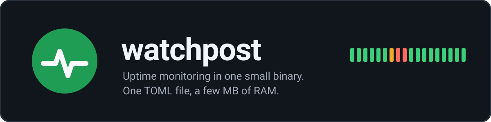
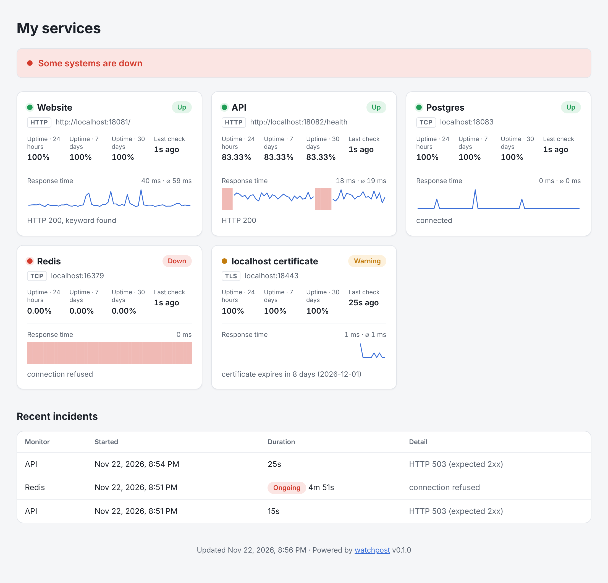
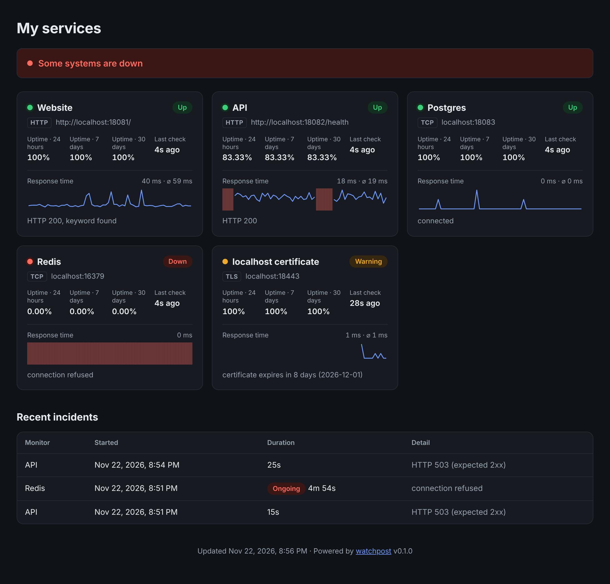
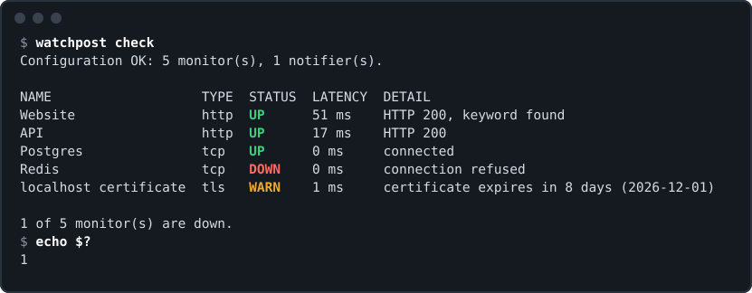
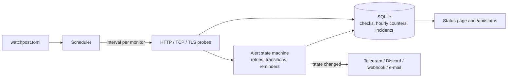

<p align="center">
  
</p>

<p align="center">
  A single-binary uptime monitor for websites, ports and TLS certificates, with alerts and a built-in status page.
</p>

<p align="center">
  <a href="https://github.com/hytztrk-ux/watchpost/actions/workflows/ci.yml"></a>
  <a href="LICENSE"></a>
  
  
</p>

<p align="center">
  <b>English</b> · <a href="README.tr.md">Türkçe</a>
</p>

---

You write one TOML file listing what to watch. watchpost checks it on a
schedule, keeps the history in an embedded SQLite file, tells you on Telegram,
Discord, a webhook or e-mail when something goes down or comes back, and
serves a status page. There is no runtime to install, no database server and
no admin UI. It is meant for the small VPS, the Raspberry Pi or the old PC
that should not spend its memory on monitoring.

<p align="center">
  
  
</p>

<p align="center"><sub>The status page in light and dark theme. Real screenshots of the release
binary watching five local test services for a few minutes (one of them is down on purpose,
one fails for 30 seconds every 3 minutes, one has a certificate that expires in 8 days).</sub></p>

`watchpost check` runs every monitor once and exits non-zero if anything is
down, so it also works in scripts and CI:

<p align="center">
  
</p>

## Quick start

Building from source is the way to install it today (Rust 1.88 or newer).
Prebuilt binaries for Linux, macOS and Windows will be on the
Releases page once the first version is tagged.

```sh
cargo install --git https://github.com/hytztrk-ux/watchpost --locked

watchpost init     # writes a commented watchpost.toml
$EDITOR watchpost.toml
watchpost check    # validates the config and runs every monitor once
watchpost run      # status page on http://127.0.0.1:8787
```

A small config looks like this:

```toml
title = "My services"

[[monitor]]
name = "Website"
type = "http"
url = "https://example.com/"
keyword = "Example Domain"

[[monitor]]
name = "Postgres"
type = "tcp"
host = "db.internal"
port = 5432

[[monitor]]
name = "example.com certificate"
type = "tls"
host = "example.com"
warn_days = 14
interval = "6h"

[[notifier]]
type = "telegram"
bot_token = "${TELEGRAM_BOT_TOKEN}"
chat_id = "123456789"
```

`watchpost test-notify` sends a test message through every notifier, so you
can check the channel before something breaks.

## What it does

- **Monitors:** HTTP(S) with method, headers, body, accepted status codes,
  a keyword in the body and redirect handling; TCP connect; TLS certificate
  expiry with a warning window and optional private CA.
- **Per-monitor** interval, timeout and number of retries before a monitor
  counts as down.
- **Alerts on state changes only:** down, recovered (with the outage length)
  and certificate expiring, plus an optional reminder while something stays
  down. An open incident survives a restart without being announced twice.
- **Channels:** Telegram, Discord, generic JSON webhook, SMTP e-mail.
- **Status page and JSON API** from the same binary: current state, uptime
  over 24 hours, 7 days and 30 days, a response-time sparkline, recent
  incidents. All assets are embedded; no CDN, no JavaScript framework, and
  the page works with JavaScript disabled. English and Turkish, light and
  dark, optional basic auth. `/healthz` for your own checks.
- **Secrets from the environment:** `${TELEGRAM_BOT_TOKEN}` or
  `${NAME:-default}` anywhere in the config.
- Graceful shutdown on Ctrl-C / SIGTERM, text or JSON logs, an example
  hardened systemd unit and a `scratch` Docker image.

This is what the webhook notifier posted to a local receiver when the API
service in the screenshot came back (pretty-printed):

```json
{
  "down_since": "2026-11-22T20:54:46Z",
  "duration_seconds": 25,
  "event": "recovered",
  "message": "HTTP 200",
  "monitor": "API",
  "status": "up",
  "status_page": null,
  "subject": "[My services] RECOVERED: API",
  "target": "http://localhost:18082/health",
  "text": "🟢 [My services] RECOVERED: API\n\nTarget: http://localhost:18082/health (http)\nDetail: HTTP 200\nDown for: 25s\nTime: 2026-11-22 20:55:11 UTC",
  "timestamp": "2026-11-22T20:55:11Z",
  "title": "My services",
  "type": "http",
  "unix_time": 1795380911
}
```

## How it works



Each probe opens a fresh connection, so the measured latency includes DNS,
TCP and TLS setup the way a new visitor sees it. Delivery runs in the
background and is retried twice (after 2 s and 10 s) before the failure is
logged.

## Compared with the usual options

| | watchpost | Hosted monitoring service | Self-hosted monitor with a web admin |
|---|---|---|---|
| Where checks run | The machine it runs on (one location) | The provider's network, often several locations | The machine it runs on |
| Configuration | One TOML file you can keep in git | Web dashboard | Web dashboard, stored in its database |
| What you install | One binary; history is a SQLite file | Nothing | Usually a language runtime or a container |
| Status page | Built in, read-only | Usually included | Usually included |

If you need checks from several regions, a hosted service is the better fit.
watchpost is for watching your own things from a box you already have.

## Resource usage

Measured on this build, on the machine it was built on (Linux x86_64, glibc,
2 cores). They are measurements, not guarantees.

| | |
|---|---|
| Release binary (`target/release/watchpost`, stripped) | 4.7 MiB (4 970 200 bytes) |
| Resident memory (`VmRSS`) after 5 minutes | 8.0 MiB (8 216 kB, also the peak) |
| Threads | 7 |

The run behind these numbers was the one in the screenshots: five monitors
(four every 5 seconds, one every 30 seconds), one webhook notifier, and 400
requests to the page and the API near the end. Memory grows a little with the
number of monitors; SQLite's page cache is limited to 1 MiB.

## Documentation

The full reference is in [docs/reference.md](docs/reference.md): every
command and option, every configuration key, setup for each notification
channel, the JSON API, and running under systemd or Docker. A commented
example config is in [`watchpost.example.toml`](watchpost.example.toml);
`watchpost init` writes the same file.

## Limitations

Things watchpost v0.1 does not do, or does in a limited way:

- **One location.** All checks run from the machine watchpost runs on. A
  network problem there looks like an outage of your services.
- **No ICMP ping**, and no DNS, UDP, database-protocol or push/heartbeat
  ("cron job checked in") monitors yet.
- **The status page is read-only.** Configuration lives in the TOML file and
  changes need a restart (run `watchpost check` first). No hot reload yet.
- **TLS checks look at the leaf certificate only.** No OCSP or revocation
  checks. HTTP monitors do not warn about certificate expiry; add a `tls`
  monitor for that.
- **Uptime is bucketed hourly.** It is the share of checks that were not
  down, counted in hourly buckets, so window edges are aligned to the hour
  and a "24 h" window is the current hour plus the 23 before it. It is not
  computed from exact time.
- **History is keyed by monitor name.** Renaming a monitor starts a new
  history; the old rows age out with retention.
- **Plain-text notifications only** (no HTML e-mail, no Discord embeds), and
  no routing beyond choosing notifiers per monitor.
- **Telegram, Discord and SMTP delivery has only been tested against local
  mock servers**, not against the real services. The webhook payload above
  comes from a local receiver as well.
- Check details such as `connection refused` are in English even when
  `language = "tr"`.
- No maintenance windows and no escalation.

## Roadmap

Ideas, not promises:

- Reload the config on `SIGHUP`.
- DNS and push/heartbeat monitors.
- More channels: Slack, ntfy, Gotify, Matrix.
- Certificate-expiry warnings on HTTPS monitors.
- Maintenance windows.
- Prometheus `/metrics` and SVG uptime badges.
- Grouping monitors on the status page.

## Contributing

Bug reports and pull requests are welcome, in English or Turkish. See
[CONTRIBUTING.md](CONTRIBUTING.md).

## License

[MIT](LICENSE) © The watchpost contributors
