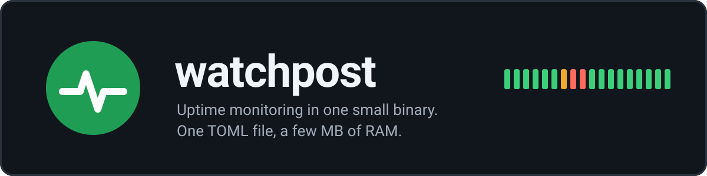
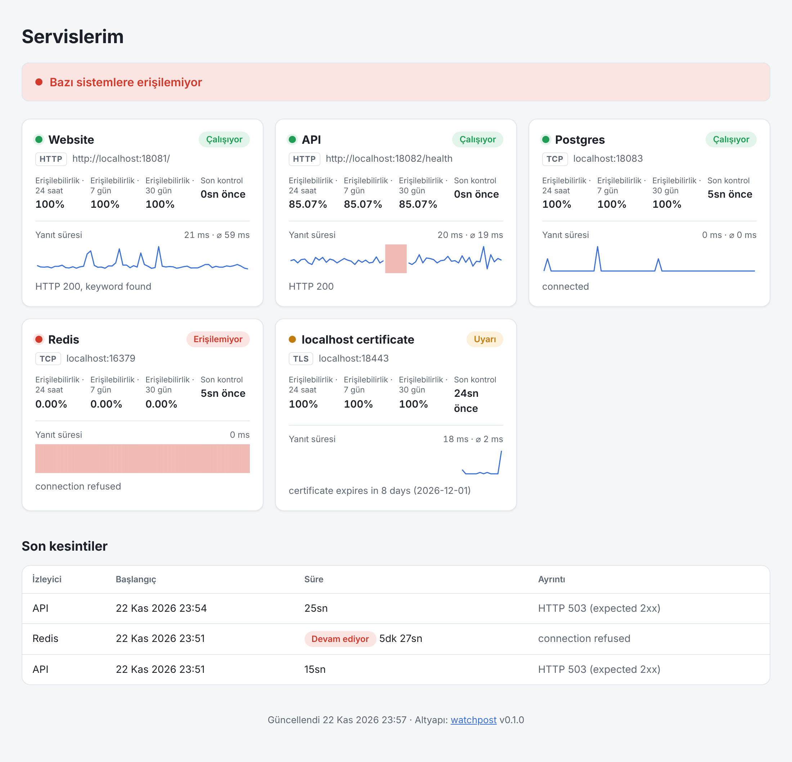
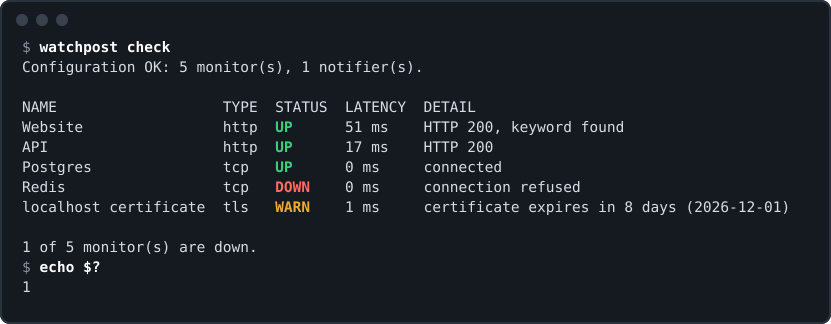
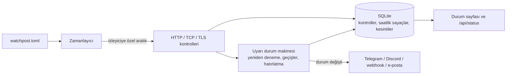

<p align="center">
  
</p>

<p align="center">
  Web siteleri, portlar ve TLS sertifikaları için tek dosyalık bir izleme aracı; bildirim gönderir, durum sayfası sunar.
</p>

<p align="center">
  <a href="https://github.com/hytztrk-ux/watchpost/actions/workflows/ci.yml"></a>
  <a href="LICENSE"></a>
  
  
</p>

<p align="center">
  <a href="README.md">English</a> · <b>Türkçe</b>
</p>

---

Neyi izlemek istediğinizi tek bir TOML dosyasına yazarsınız. watchpost
bunları belirlediğiniz aralıklarla kontrol eder, geçmişi gömülü bir SQLite
dosyasında tutar, bir şey çöktüğünde ya da düzeldiğinde Telegram, Discord,
webhook veya e-postayla haber verir ve bir durum sayfası sunar. Kurulacak bir
çalışma ortamı, veritabanı sunucusu ya da yönetim paneli yoktur. Belleğini
izlemeye harcamaması gereken küçük bir VPS, bir Raspberry Pi ya da eski bir
bilgisayar için yazıldı.

<p align="center">
  
</p>

<p align="center"><sub>Türkçe durum sayfası. Release derlemesinin, birkaç dakika boyunca beş yerel
test servisini izlerken alınmış gerçek ekran görüntüsü (biri bilerek kapalı, biri 3 dakikada bir
30 saniyeliğine hata veriyor, birinin sertifikası 8 gün sonra doluyor). Açık ve koyu temanın
İngilizce görüntüleri <a href="README.md">İngilizce README</a>'de.</sub></p>

`watchpost check` her izleyiciyi bir kez çalıştırır ve erişilemeyen bir şey
varsa sıfırdan farklı bir kodla çıkar; bu yüzden betiklerde ve CI'da da
kullanılabilir. Komut satırı çıktısı İngilizcedir:

<p align="center">
  
</p>

## Hızlı başlangıç

Bugün için kurulum yolu kaynak koddan derlemektir (Rust 1.88 veya üstü).
Linux, macOS ve Windows için hazır derlemeler, ilk sürüm etiketlendiğinde
Releases sayfasına eklenecek.

```sh
cargo install --git https://github.com/hytztrk-ux/watchpost --locked

watchpost init     # açıklamalı bir watchpost.toml yazar
$EDITOR watchpost.toml
watchpost check    # yapılandırmayı doğrular, her izleyiciyi bir kez çalıştırır
watchpost run      # durum sayfası: http://127.0.0.1:8787
```

Küçük bir yapılandırma şöyle görünür:

```toml
language = "tr"
title = "Servislerim"

[[monitor]]
name = "Web sitesi"
type = "http"
url = "https://example.com/"
keyword = "Example Domain"

[[monitor]]
name = "Postgres"
type = "tcp"
host = "db.internal"
port = 5432

[[monitor]]
name = "example.com sertifikası"
type = "tls"
host = "example.com"
warn_days = 14
interval = "6h"

[[notifier]]
type = "telegram"
bot_token = "${TELEGRAM_BOT_TOKEN}"
chat_id = "123456789"
```

`watchpost test-notify` tüm bildirim kanallarına bir test mesajı gönderir;
böylece bir şey bozulmadan önce kanalın çalıştığını görebilirsiniz.

## Neler yapar

- **İzleyiciler:** HTTP(S) (metot, başlıklar, gövde, kabul edilen durum
  kodları, gövdede anahtar kelime, yönlendirmeler); TCP bağlantısı; uyarı
  aralığı ve isteğe bağlı kurum içi CA ile TLS sertifika süresi.
- **Her izleyici için ayrı** kontrol aralığı, zaman aşımı ve "erişilemiyor"
  sayılmadan önceki yeniden deneme sayısı.
- **Yalnızca durum değişince bildirim:** erişilemiyor, düzeldi (kesinti
  süresiyle birlikte) ve sertifika süresi doluyor; isteğe bağlı olarak kesinti
  sürdükçe hatırlatma. Açık bir kesinti yeniden başlatmadan sonra ikinci kez
  duyurulmaz.
- **Kanallar:** Telegram, Discord, genel JSON webhook, SMTP e-posta.
- **Durum sayfası ve JSON API** aynı programdan: anlık durum, 24 saat / 7 gün
  / 30 gün erişilebilirlik, yanıt süresi grafiği, son kesintiler. Tüm dosyalar
  programın içine gömülüdür; CDN ya da JavaScript çatısı yoktur ve sayfa
  JavaScript kapalıyken de çalışır. Türkçe ve İngilizce, açık ve koyu tema,
  isteğe bağlı parola koruması. Kendi kontrolleriniz için `/healthz`.
- **Gizli bilgiler ortam değişkenlerinden:** yapılandırmanın herhangi bir
  yerinde `${TELEGRAM_BOT_TOKEN}` ya da `${AD:-varsayılan}`.
- Ctrl-C / SIGTERM ile düzgün kapanma, metin veya JSON günlük, sıkılaştırılmış
  örnek bir systemd birimi ve `scratch` tabanlı bir Docker imajı.

Ekran görüntüsündeki API servisi düzeldiğinde webhook kanalının yerel bir
alıcıya gönderdiği gövde (okunaklı biçimde):

```json
{
  "down_since": "2026-11-22T20:54:46Z",
  "duration_seconds": 25,
  "event": "recovered",
  "message": "HTTP 200",
  "monitor": "API",
  "status": "up",
  "status_page": null,
  "subject": "[My services] RECOVERED: API",
  "target": "http://localhost:18082/health",
  "text": "🟢 [My services] RECOVERED: API\n\nTarget: http://localhost:18082/health (http)\nDetail: HTTP 200\nDown for: 25s\nTime: 2026-11-22 20:55:11 UTC",
  "timestamp": "2026-11-22T20:55:11Z",
  "title": "My services",
  "type": "http",
  "unix_time": 1795380911
}
```

Bu örnek `language = "en"` ile alındı; `language = "tr"` olduğunda `subject`
ve `text` alanları Türkçe olur.

## Nasıl çalışır



Her kontrol yeni bir bağlantı açar; ölçülen gecikme, yeni bir ziyaretçinin
göreceği gibi DNS, TCP ve TLS kurulumunu da içerir. Bildirimler arka planda
gönderilir ve hata günlüğe yazılmadan önce iki kez daha denenir (2 sn ve
10 sn sonra).

## Diğer seçeneklerle karşılaştırma

| | watchpost | Barındırılan izleme servisi | Web panelli, kendi sunucunuzda çalışan izleyici |
|---|---|---|---|
| Kontroller nereden yapılır | Çalıştığı makineden (tek konum) | Sağlayıcının ağından, çoğu zaman birden çok konumdan | Çalıştığı makineden |
| Yapılandırma | Git'te tutulabilen tek bir TOML dosyası | Web paneli | Web paneli, kendi veritabanında |
| Ne kurarsınız | Tek bir program; geçmiş bir SQLite dosyası | Hiçbir şey | Genellikle bir çalışma ortamı ya da konteyner |
| Durum sayfası | Yerleşik, salt okunur | Genellikle var | Genellikle var |

Birden çok bölgeden kontrol gerekiyorsa barındırılan bir servis daha uygun
olur. watchpost, kendi servislerinizi zaten elinizde olan bir makineden
izlemek içindir.

## Kaynak kullanımı

Bu derlemede, derlendiği makinede ölçüldü (Linux x86_64, glibc, 2 çekirdek).
Garanti değil, ölçümdür.

| | |
|---|---|
| Release derlemesi (`target/release/watchpost`, sembolleri ayıklanmış) | 4,7 MiB (4.970.200 bayt) |
| Bellek (`VmRSS`), 5 dakika sonra | 8,0 MiB (8.216 kB, aynı zamanda en yüksek değer) |
| İş parçacığı | 7 |

Ölçüm, ekran görüntülerindeki çalıştırmadan alındı: beş izleyici (dördü 5
saniyede, biri 30 saniyede bir), bir webhook kanalı ve sona doğru sayfaya ve
API'ye yapılan 400 istek. İzleyici sayısı arttıkça bellek biraz artar; SQLite
sayfa önbelleği 1 MiB ile sınırlıdır.

## Belgeler

Ayrıntılı başvuru belgesi [docs/reference.tr.md](docs/reference.tr.md)
dosyasındadır: tüm komutlar ve seçenekler, tüm yapılandırma anahtarları, her
bildirim kanalının kurulumu, JSON API, systemd ve Docker ile çalıştırma.
Açıklamalı örnek yapılandırma [`watchpost.example.toml`](watchpost.example.toml)
dosyasındadır; `watchpost init` de aynı dosyayı yazar.

## Sınırlamalar

watchpost v0.1'in yapmadığı ya da sınırlı yaptığı şeyler:

- **Tek konum.** Tüm kontroller watchpost'un çalıştığı makineden yapılır. O
  makinedeki bir ağ sorunu, servislerinizde kesinti varmış gibi görünür.
- **ICMP ping yok.** DNS, UDP, veritabanı protokolü ya da push/heartbeat
  ("cron işi haber verdi mi") izleyicileri de henüz yok.
- **Durum sayfası salt okunurdur.** Yapılandırma TOML dosyasındadır ve
  değişiklikler yeniden başlatma gerektirir (önce `watchpost check`). Canlı
  yeniden yükleme henüz yok.
- **TLS kontrolü yalnızca son sertifikaya (leaf) bakar.** OCSP veya iptal
  kontrolü yapılmaz. HTTP izleyicileri sertifika süresi için uyarmaz; bunun
  için bir `tls` izleyicisi ekleyin.
- **Erişilebilirlik saatlik dilimlerle hesaplanır.** `down` olmayan
  kontrollerin oranıdır ve saatlik sayaçlarla tutulur; pencere sınırları saat
  başına hizalıdır, "24 saat" penceresi içinde bulunulan saat ile önceki 23
  saattir. Kesin süreden hesaplanmaz.
- **Geçmiş izleyici adıyla tutulur.** Adı değiştirilen izleyici için yeni bir
  geçmiş başlar; eski kayıtlar saklama süresi dolunca silinir.
- **Bildirimler yalnızca düz metindir** (HTML e-posta yok, Discord embed yok)
  ve izleyici başına kanal seçmenin ötesinde yönlendirme yoktur.
- **Telegram, Discord ve SMTP gönderimi yalnızca yerel sahte sunuculara (mock)
  karşı denendi**, gerçek servislere karşı değil. Yukarıdaki webhook gövdesi de
  yerel bir alıcıdan alındı.
- Kontrol ayrıntıları (ör. `connection refused`) `language = "tr"` olsa da
  İngilizcedir.
- Bakım pencereleri ve kademeli bildirim (escalation) yoktur.

## Yol haritası

Söz değil, fikir:

- `SIGHUP` ile yapılandırmayı yeniden yükleme.
- DNS ve push/heartbeat izleyicileri.
- Yeni kanallar: Slack, ntfy, Gotify, Matrix.
- HTTPS izleyicilerinde sertifika süresi uyarısı.
- Bakım pencereleri.
- Prometheus `/metrics` ve SVG erişilebilirlik rozetleri.
- Durum sayfasında izleyicileri gruplama.

## Katkıda bulunma

Hata bildirimlerine ve pull request'lere açığız; İngilizce ya da Türkçe
yazabilirsiniz. Ayrıntılar [CONTRIBUTING.md](CONTRIBUTING.md) dosyasında.

## Lisans

[MIT](LICENSE) © The watchpost contributors
